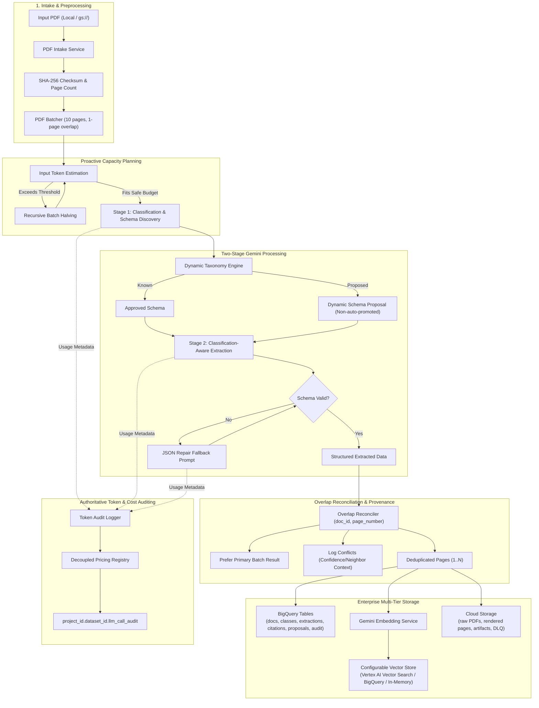

# Vertex AI Intelligent PDF Classification and Extraction Pipeline

A production-grade Python solution for automated, multimodal classification, metadata enrichment, dynamic schema generation, and information extraction from complex PDFs using Google Gemini on Vertex AI.

---

## 1. Architecture and Pipeline Flow



---

## 2. Component Responsibilities

| Component | Responsibility |
| :--- | :--- |
| **`PDFIntakeService`** | Ingests PDFs from local filesystem or `gs://` URIs; calculates cryptographic SHA-256 hashes; measures page count; mints deterministic `document_id` and `processing_run_id`. |
| **`PDFBatchingService`** | Slices documents into configurable batches (default: 10 pages with 1-page overlap); assigns `is_primary` tags; performs proactive token estimation; recursively halves batches if capacity thresholds are exceeded. |
| **`GeminiClientWrapper`** | Unified `call_gemini` interface; validates structured JSON outputs against Pydantic models; extracts authoritative post-execution token metrics (`prompt`, `candidates`, `thoughts`, `cached_content`, `total`); executes JSON repair prompts on validation errors. |
| **`TokenAuditLogger`** | Authoritative telemetry sink logging every Gemini call (success, retry, failure) to BigQuery; computes costs via decoupled pricing tables; never stores raw Chain-of-Thought reasoning. |
| **`DynamicSchemaManager`** | Manages canonical taxonomy and default extraction schemas; normalizes proposed classifications to snake_case; registers proposed schemas with `status='proposed'` (strict non-auto-promotion invariant). |
| **`ClassificationService`** | Executes Stage 1 prompt; performs document-level and page-level classification; profiles modalities (handwritten, scanned, tables, drawings, images); proposes schemas for new document types. |
| **`ExtractionService`** | Executes Stage 2 prompt using classification context; extracts typed/handwritten text, scanned indicators, tables (2D grids + markdown), visual asset metadata, and classification entities; enforces strict `null` semantics without hallucinations. |
| **`CitationManager`** | Generates source citations anchoring every extracted value and table to physical PDF page numbers and bounding boxes `[ymin, xmin, ymax, xmax]`; tracks complete field-level lineage. |
| **`OverlapReconciler`** | Deduplicates adjacent batch boundary pages using `(document_id, page_number)`; prioritizes primary batch owners; resolves classification conflicts using confidence deltas; prevents duplicate citations and embeddings. |
| **`EmbeddingService`** | Chunks extracted pages and tables; computes text embeddings via `gemini-embedding-001` or `gemini-embedding-2`; attaches lineage metadata. |
| **`VectorStoreRepository`** | Abstract interface supporting pluggable backends: `VertexAIVectorSearchRepository`, `BigQueryVectorSearchRepository`, and `InMemoryVectorStoreRepository`. |
| **`RetryAndFallbackHandler`** | Manages exponential backoff with jitter; executes reactive batch halving on context limits or token truncation; routes unrecoverable single-page failures to Dead-Letter Storage (DLQ). |
| **`PDFProcessingOrchestrator`** | End-to-end pipeline coordinator; executes the 8-step workflow and enforces 11 production validation invariants. |

---

## 3. Repository Structure

```
.
├── Dockerfile                          # Multi-stage production container definition
├── README.md                           # Architecture and operations documentation
├── pyproject.toml                      # Package packaging and test configuration
├── requirements.txt                    # Production runtime dependencies
├── pdf_pipeline/
│   ├── __init__.py
│   ├── cli.py                          # Command-line interface entrypoint
│   ├── config/
│   │   ├── __init__.py
│   │   ├── pricing.py                  # Model pricing registry and cost formulas
│   │   └── settings.py                 # Pydantic BaseSettings environment configuration
│   ├── core/
│   │   ├── __init__.py
│   │   ├── audit_logger.py             # BigQuery token and cost audit sink
│   │   ├── exceptions.py               # Custom pipeline exception hierarchy
│   │   ├── gemini_client.py            # Unified call_gemini wrapper & JSON repair
│   │   └── retry_handler.py            # Exponential backoff, batch halving, DLQ
│   ├── models/
│   │   ├── __init__.py
│   │   ├── audit.py                    # LLMCallAuditRecord schema
│   │   ├── citation.py                 # Citation, BoundingBox, LineageRecord
│   │   ├── classification.py           # Stage 1 classification & proposed schema models
│   │   ├── document.py                 # DocumentMetadata, PageBatch, BatchPage
│   │   └── extraction.py               # Stage 2 structured extraction & table models
│   ├── repositories/
│   │   ├── __init__.py
│   │   ├── base.py                     # ObjectStorage, Database, VectorStore ABCs
│   │   ├── bigquery_repo.py            # Production BigQuery repository
│   │   ├── gcs_repo.py                 # GCS storage repository with local fallback
│   │   └── vector_store_repo.py        # Pluggable vector store backends
│   └── services/
│       ├── __init__.py
│       ├── batching_service.py         # 10-page / 1-overlap batching & token optimizer
│       ├── citation_manager.py         # Provenance binding & lineage extraction
│       ├── classification_service.py   # Stage 1 Gemini service
│       ├── embedding_service.py        # Gemini embedding generation & vector storage
│       ├── extraction_service.py       # Stage 2 Gemini service
│       ├── intake_service.py           # File intake, SHA-256, page count detection
│       ├── orchestrator.py             # End-to-end pipeline orchestrator & validator
│       ├── overlap_reconciler.py       # Boundary page deduplication & conflict resolver
│       └── schema_manager.py           # Dynamic schema registry & taxonomy manager
├── sql/
│   ├── 01_llm_call_audit.sql           # BigQuery DDL: LLM call audit table
│   ├── 02_document_metadata.sql        # BigQuery DDL: Ingestion metadata table
│   ├── 03_page_classifications.sql     # BigQuery DDL: Page classification table
│   ├── 04_extracted_pages.sql          # BigQuery DDL: Structured extraction table
│   ├── 05_citations.sql                # BigQuery DDL: Field-level citations table
│   ├── 06_proposed_classifications.sql # BigQuery DDL: Proposed taxonomies table
│   └── 07_pricing_reference.sql        # BigQuery DDL: Model pricing reference table
└── tests/
    ├── __init__.py
    ├── conftest.py                     # Pytest fixtures and synthetic PDF generators
    ├── test_batching.py                # 28-page batching, overlap, & splitting tests
    ├── test_citation_manager.py        # Citation creation and lineage tests
    ├── test_gemini_client.py           # Structured output & JSON repair tests
    ├── test_orchestrator.py            # End-to-end pipeline integration tests
    ├── test_overlap_reconciler.py      # Deduplication & conflict resolution tests
    ├── test_pricing_and_audit.py       # Cost calculation & token audit tests
    └── test_schema_manager.py          # Taxonomy & snake_case tests
```

---

## 4. Key Technical Decisions & Invariants

1. **Deterministic Primary Page Ownership**:
   - For any document with $N$ pages and batch window size 10 with 1-page overlap:
     - Batch 1 (1–10): Primary = `[1..10]`
     - Batch 2 (10–19): Overlap = `[10]`, Primary = `[11..19]`
     - Batch 3 (19–28): Overlap = `[19]`, Primary = `[20..28]`
   - Every physical page $p \in [1, N]$ has **exactly one** primary owner batch. Boundary pages are processed within adjacent context but deduplicated unconditionally.
2. **Semi-Dynamic Taxonomy & Non-Auto-Promotion**:
   - Gemini classifies pages against canonical known document types (`invoice`, `work_order`, `contract_agreement`, etc.).
   - If an uncatalogued document type is discovered, Gemini proposes a normalized `snake_case` name, distinguishing visual features, and a candidate extraction JSON schema with `classification_status='proposed'`.
   - Proposed classifications are saved in BigQuery `proposed_classifications` for human review and never promoted automatically.
3. **Strict Citation Grounding & Zero Hallucination**:
   - Every extracted field has an attached `Citation` linking to the authoritative physical PDF page number, verbatim source text evidence, bounding box `[ymin, xmin, ymax, xmax]`, and confidence score.
   - Values inferred rather than explicitly observed have `is_inferred=True`.
   - Missing fields return `null`. The model prompt explicitly forbids fabrication or hallucination.
4. **Authoritative Token Logging & Decoupled Pricing**:
   - Every Gemini API invocation (Stage 1, Stage 2, JSON repair, failed calls) is logged in BigQuery `llm_call_audit` partitioned by date.
   - Token metrics are taken directly from post-execution `response.usage_metadata`: `prompt_token_count`, `candidates_token_count`, `thoughts_token_count` (thinking tokens), and `cached_content_token_count`.
   - Internal Chain-of-Thought text is never persisted; only the quantitative thinking token count is stored.
   - Pricing rates are decoupled into `PricingRegistry` / BigQuery reference tables.
5. **Two-Tier Resilient Fallbacks**:
   - *Proactive*: Estimates batch tokens via `count_tokens` before dispatch. If tokens exceed `token_safety_threshold`, the batch is halved recursively down to single pages.
   - *Reactive*: On context-limit errors or output token truncation (`finish_reason='MAX_TOKENS'`), the batch is halved and retried. Unrecoverable single pages are dispatched to the Dead-Letter Queue (DLQ) with raw diagnostic payloads. No page is ever silently dropped.

---

## 5. Local Setup and Execution

### Prerequisites
- Python 3.10+ (tested on Python 3.12)
- Google Cloud SDK (`gcloud`) authenticated via Application Default Credentials (`gcloud auth application-default login`)

### Installation
```bash
# 1. Create and activate a clean virtual environment
python3 -m venv .venv
source .venv/bin/activate

# 2. Install dependencies
.venv/bin/pip install -r requirements.txt
```

### Environment Configuration
Create a `.env` file in the project root:
```ini
PDF_PIPELINE_PROJECT_ID=your-gcp-project-id
PDF_PIPELINE_LOCATION=us-central1
PDF_PIPELINE_USE_VERTEX_AI=true
PDF_PIPELINE_BQ_DATASET_ID=pdf_intelligence
PDF_PIPELINE_GCS_BUCKET_NAME=your-gcs-bucket
PDF_PIPELINE_BATCH_SIZE=10
PDF_PIPELINE_OVERLAP_SIZE=1
PDF_PIPELINE_TOKEN_SAFETY_THRESHOLD=600000
PDF_PIPELINE_VECTOR_STORE_TYPE=in_memory
```

### Running Tests
Execute the comprehensive test suite:
```bash
.venv/bin/pytest -v
```

### Running the CLI Pipeline
```bash
# Process a local PDF
.venv/bin/python -m pdf_pipeline.cli /path/to/document.pdf --output-json result.json

# Process a GCS PDF
.venv/bin/python -m pdf_pipeline.cli gs://your-bucket/raw/document.pdf --batch-size 10 --overlap-size 1
```

---

## 6. BigQuery Provisioning

Execute the SQL scripts in order using `bq query`:
```bash
PROJECT_ID="your-gcp-project-id"
DATASET_ID="pdf_intelligence"

# Create BigQuery dataset
bq --location=US mk --dataset ${PROJECT_ID}:${DATASET_ID}

# Apply DDL scripts
for script in sql/*.sql; do
    sed -e "s/{{project_id}}/${PROJECT_ID}/g" -e "s/{{dataset_id}}/${DATASET_ID}/g" "$script" | bq query --use_legacy_sql=false
done
```

---

## 7. Containerized Deployment (Docker / Cloud Run)

### Build and Test Container
```bash
# Build production container image
docker build -t gcr.io/your-project/vertex-gemini-pdf-pipeline:latest .

# Run container locally with volume mount
docker run --rm \
    -v ~/.config/gcloud:/home/pipeline/.config/gcloud:ro \
    -e GOOGLE_APPLICATION_CREDENTIALS=/home/pipeline/.config/gcloud/application_default_credentials.json \
    -e PDF_PIPELINE_PROJECT_ID=your-project \
    gcr.io/your-project/vertex-gemini-pdf-pipeline:latest \
    gs://your-bucket/sample.pdf
```
